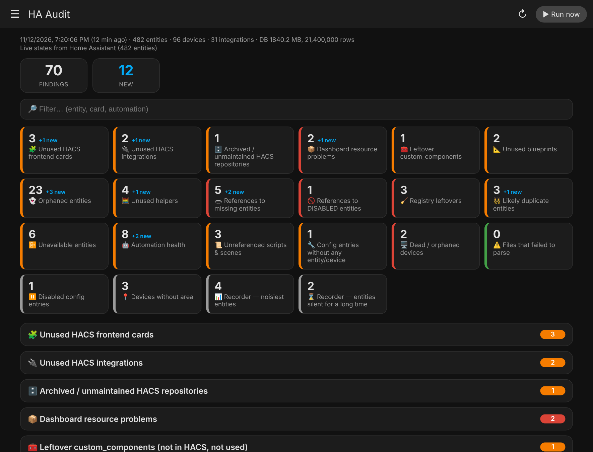
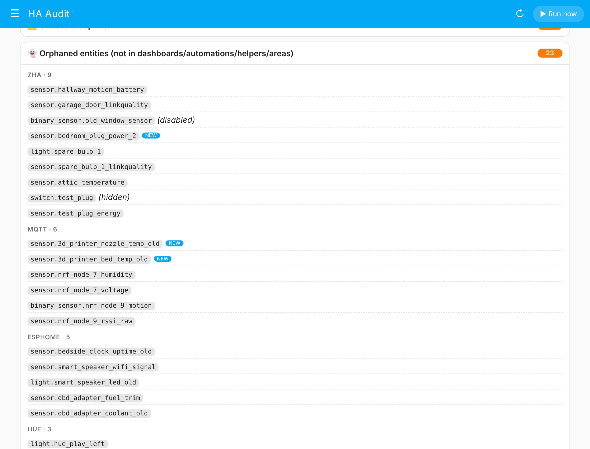
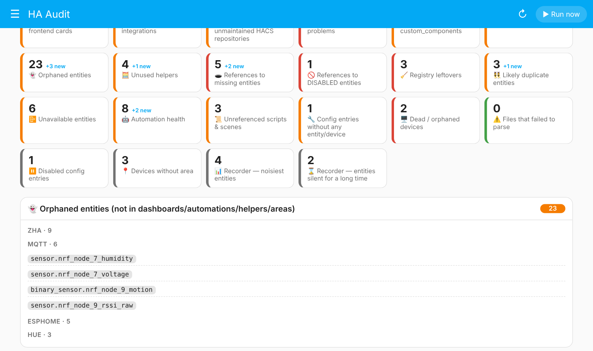
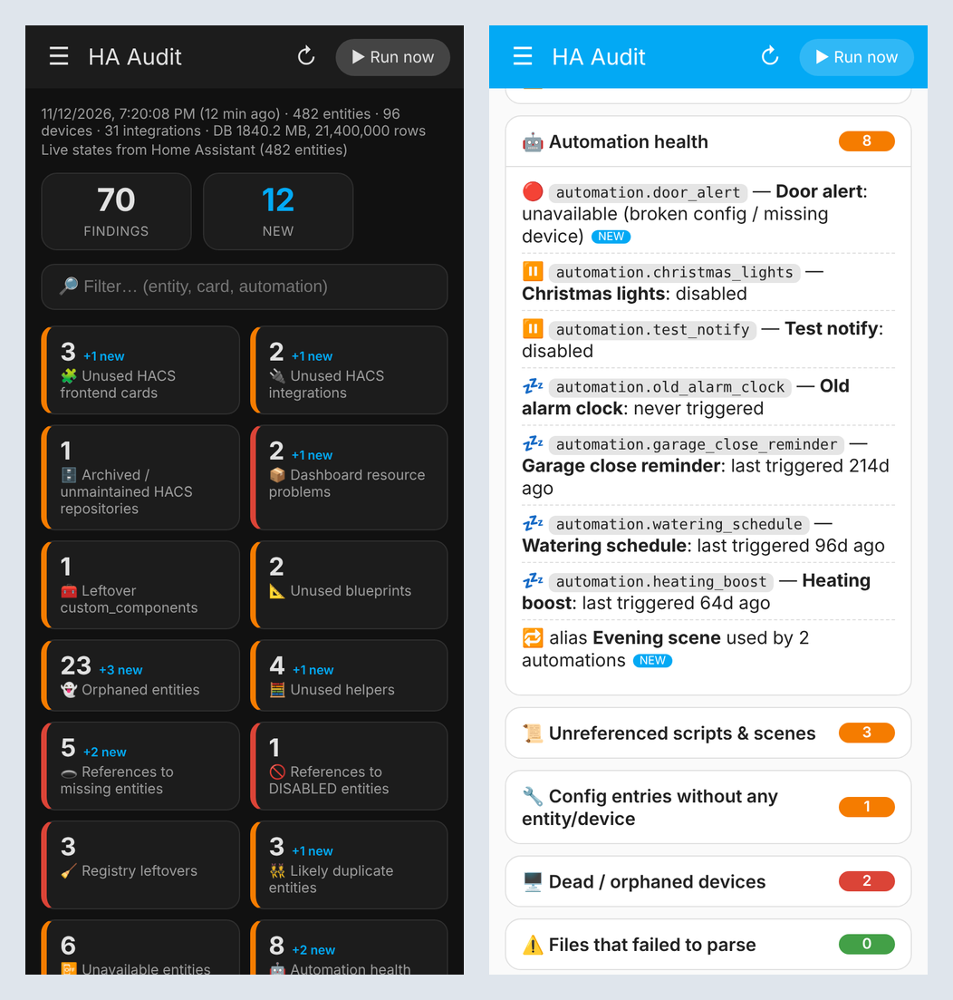

<p align="center"></p>

# 🏠 HA Audit

**A read-only audit for Home Assistant.** Finds unused entities, dead HACS items, broken
references and automation rot — and shows them in a themed sidebar panel.
It never changes or deletes anything; you review and clean up yourself.

> 🤖 **Vibe coded.** This project was built together with an AI assistant (Claude). It has automated tests,
> but it hasn't been battle-tested on many setups — review the code, and double-check every finding
> before you remove anything.

> Ελληνικός οδηγός εγκατάστασης: [docs/SETUP.el.md](docs/SETUP.el.md)

## Screenshots

Overview with a summary tile per category (dark theme):



Orphaned entities grouped by integration, with `NEW` badges (light theme):



Live filter across every section:



Works on the phone too (dark and light):



<sub>Screenshots use demo data. The panel follows your Home Assistant theme.</sub>

## What it finds

| Area | Checks |
|---|---|
| **HACS** | unused frontend cards (matched against the real custom elements inside each card's JS), unused integrations, archived repos, missing/duplicate dashboard resources, cards not registered as resources, leftover `custom_components`, unused blueprints |
| **Entities** | orphaned entities (not used in dashboards, automations, templates, helpers, areas, labels, voice exposure, energy…), unused helpers, **references to entities that don't exist**, references to disabled entities, registry leftovers of removed integrations, `_2` duplicates, unavailable entities |
| **Automations** | broken (unavailable), disabled, never triggered / stale, duplicate aliases, unreferenced scripts & scenes |
| **Devices** | config entries without entities/devices, dead/orphaned devices, devices without area (info) |
| **Recorder** | DB size, noisiest entities, entities silent for N days (read-only SQLite, with timeout) |
| **Other** | YAML/JSON files that fail to parse, "new since last run" diff, ignore file |

Detection understands `!include` / `!secret`, Jinja templates, entity registry UUIDs
(device triggers/actions), `area_id` / `label_id` / `floor_id` targets, UI helpers
(template, group, utility_meter, threshold…), the Energy dashboard and voice exposure.

## 🔒 Security model

* **Nothing is written to `/config/www`.** That folder is served over HTTP **without login**.
* The report is stored in `/config/.storage/ha_audit` (not web-served).
* The UI gets the report over the **authenticated WebSocket API, admin users only**.
  The panel's JS file is public but contains no data.
* The sidebar panel is **admin-only**.
* The audit only *reads* files in your config directory and the recorder DB (SQLite opened `mode=ro`).
* The sensors expose only small counters, never entity names.

## Install

### HACS (custom repository)
1. HACS → ⋮ → **Custom repositories** → add `https://github.com/samlisg/ha-audit`, category **Integration**
   (HACS can only install **public** repos — for a private repo use the manual method).
2. Install **HA Audit**, then **restart Home Assistant**.

### Manual
Copy `custom_components/ha_audit/` into `/config/custom_components/ha_audit/` and restart.

## Setup

1. **Settings → Devices & services → Add integration → HA Audit**.
2. Choose options (changeable later via *Configure*):
   * run automatically every N days (`0` = manual only; default 7)
   * flag automations/entities silent for N days (default 30)
   * flag entities unavailable for N days (default 3)
   * analyse the recorder DB, include diagnostic entities, notify on new findings
3. Open **HA Audit** in the sidebar and press **Run now** (the first run also happens
   automatically ~2 minutes after startup, and then every N days).

## Using it

* **Sidebar panel** (`/ha-audit`) – summary tiles, collapsible sections, live filter, `NEW` badges.
  If another dashboard already uses `/ha-audit`, the panel is registered at `/ha-audit-report` instead
  (a warning is logged) and your dashboard is never touched.
* **Sensors** – `sensor.ha_audit_findings` (attributes = counts per category),
  `sensor.ha_audit_new_findings`, `sensor.ha_audit_last_run`.
* **Service** – `ha_audit.run`.
* **Event** – `ha_audit_completed` with `total`, `new` and per-category counts.

Push notification only when something new appears:

```yaml
automation:
  - alias: HA Audit — push on new findings
    triggers:
      - trigger: event
        event_type: ha_audit_completed
    conditions:
      - condition: template
        value_template: "{{ trigger.event.data.new > 0 }}"
    actions:
      - action: notify.mobile_app_YOUR_PHONE
        data:
          title: HA Audit
          message: "{{ trigger.event.data.new }} new findings ({{ trigger.event.data.total }} total)"
          data:
            url: /ha-audit
```

Dashboard button:

```yaml
type: button
name: Run HA Audit
icon: mdi:play-circle-outline
tap_action:
  action: perform-action
  perform_action: ha_audit.run
```

## Ignoring false positives

Create `/config/ha_audit_ignore.yaml` (glob patterns, case-insensitive, all keys optional):

```yaml
entities:       [sensor.always_quiet_*, light.test_*]
domains:        [update]
platforms:      [zha]                  # everything from an integration
hacs:           ["*mushroom*", "hacs/integration"]
devices:        ["Test device*"]
config_entries: [Backup]
```

## Standalone CLI

```bash
python3 scripts/ha_audit_cli.py --config /config                 # Markdown to stdout
python3 scripts/ha_audit_cli.py --config /config --json out.json --md out.md --state-file state.json
HA_TOKEN=… python3 scripts/ha_audit_cli.py --config /config      # live states via API
```
The CLI refuses to write reports inside `<config>/www`.

## Limitations

* An entity built dynamically in a template (`states('sensor.' ~ room)`) can't be traced,
  so it may be listed as an orphan. Use the ignore file.
* "Orphaned" means *not referenced by anything HA can see*. External consumers
  (Node-RED, AppDaemon, other apps via API) aren't visible — review before deleting.
* Entities defined in YAML without `unique_id` are detected via live states.
* Recorder analysis supports SQLite only (the default).
* Malformed files never crash the audit: they (and any failing check) are listed under
  *Files that failed to parse*.

## Development

```bash
pip install pyyaml pytest
pytest -q                                  # engine/CLI tests; integration tests are skipped without the HA plugin

# full integration tests (Python 3.13)
pip install pytest-homeassistant-custom-component home-assistant-frontend
pytest -q
```

## License
MIT
